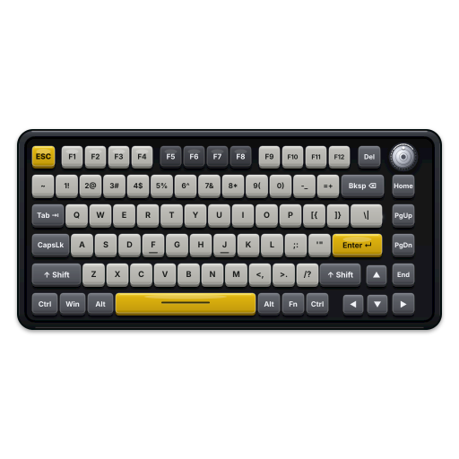

<div align="center">



# AJAZZ AK820 Web Driver

**Configure the AJAZZ AK820 mechanical keyboard directly in your browser with zero installs.**

### [▶ Open the live app: ak820-web.vercel.app](https://ak820-web.vercel.app)

<a href="LICENSE"></a>
<a href="package.json"></a>
<a href="https://developer.mozilla.org/docs/Web/API/WebHID_API"></a>
<a href="https://react.dev"></a>
<a href="https://www.typescriptlang.org"></a>
<a href="https://vite.dev"></a>
<a href="https://nodejs.org"></a>

<p align="center">
  <a href="#features">Features</a> •
  <a href="#quickstart">Quickstart</a> •
  <a href="#protocol">Protocol</a> •
  <a href="#development">Development</a> •
  <a href="#troubleshooting">Troubleshooting</a>
</p>

</div>

---

No installation, no background services, and no administrator privileges required. Works on **Windows**, **macOS**, and **Linux** in Google Chrome, Microsoft Edge, and any modern Chromium browser.

While the official vendor suite is Windows-only, this driver communicates directly with the keyboard over the [WebHID API](https://developer.mozilla.org/docs/Web/API/WebHID_API). The packet framing is reverse-engineered directly from real USB traffic, verified byte-for-byte against hardware captures, and tested on physical AK820 devices.

> **Disclaimer:** Independent open-source project. Not affiliated with or endorsed by AJAZZ.

---

## Features

| Capability | Highlights |
|---|---|
| 💡 **Lighting & Effects** | Static colors plus **17 built-in hardware animations** (Wave, Cloud, Breath, Ripple, Spectrum, etc.). Adjustable brightness (0–4), speed (0–4), direction, and random color mode. |
| 🎨 **Per-Key RGB Canvas** | Click individual keycaps on the interactive 75% on-screen keyboard to paint custom colors into the 128 LED matrix memory slots (`0x400`). |
| ⌨️ **Key Remapping** | Remap any key slot to any standard HID keycode, or restore defaults with one click. Real-time visual keycap badge previews. |
| ⚡ **Macro Engine** | Assign a hardware text sequence (alphanumeric + space, up to 20 characters) with customizable keystroke delays to any key. |
| 🎛️ **Hardware Options** | Toggle Windows Key Lock, WASD ↔ Arrow Key Swap, and USB Report Polling Rate (1000 Hz, 500 Hz, 250 Hz, 125 Hz). |
| 💾 **Profiles** | Save, load, export, and import lighting profiles in your browser (`localStorage`). Import includes defensive size and payload validation. |
| 🧪 **Demo Mode** | Test the full interface without hardware connected. Keyboard keypresses simulate audio switch feedback and physical key travel. |

> All changes are written directly to keyboard EEPROM and persist across reboots and unplugging.

## Requirements

| | |
|---|---|
| Browser | Chrome or Edge 89+, or another Chromium browser. Firefox and Safari don't support WebHID. |
| Connection | USB-C cable, keyboard switched to **wired** mode |
| Page origin | HTTPS or `http://localhost` (WebHID needs a secure context) |
| Keyboard | AK820, EVision family (VID `0x320F`, PID `0x505B`), which is verified. The Sonix family (AK820 Pro) is best-effort. |

## Quickstart

1. Plug in the keyboard and set it to **wired** mode.
2. Open the app and click **Connect keyboard**, then select the AK820 in the browser's device chooser.
3. Choose an effect and color, then click **Apply to keyboard** (or press `Ctrl` + `Enter`).

Nothing is sent until you click Apply. The status bar beside the button highlights pending changes.

## Development

Requires Node.js 18 or newer.

```bash
npm install
npm run dev       # dev server at http://localhost:5173
npm run build     # type-check + production build into dist/
npm run preview   # serve the production build
npm run lint      # type-check only
npm run check     # protocol self-check against vendor captures
```

`npm run check` uses Node's built-in TypeScript type stripping, so it needs Node 22.6+ (or 23+).

Release notes live in [`CHANGELOG.md`](CHANGELOG.md).

## Project structure

```
├── index.html               Vite HTML entry
├── public/                  Static assets (AK820 vector icon, wired keyboard photo)
├── src/
│   ├── main.tsx             React application entry point
│   ├── App.tsx              Root state orchestration, navigation and apply pipeline
│   ├── styles.css           Design tokens and component styling
│   ├── components/          UI components (BoardRender, KeyRemapPanel, KeyboardOptionsPanel,
│   │                        LightingControls, ProfilesPanel, SettingsPanel, Shell)
│   └── lib/
│       ├── protocol.ts      64-byte HID packet builders, checksum and bitmask encodings
│       ├── device.ts        WebHIDController and MockController
│       ├── keymap.ts        AK820 75% key matrix geometry and scancode definitions
│       ├── store.ts         Defensive localStorage state persistence & validation
│       ├── hooks.ts         Device hooks and I/O coordination
│       └── types.ts         TypeScript domain interfaces
├── scripts/check-protocol.ts  Hardware packet capture verification suite
├── docs/
│   ├── protocol.md          Reverse-engineered AK820 protocol specification
│   ├── legacy-protocol-notes.md  Historical research notes on Sonix/Microdia
│   └── RE-HANDOFF.md        Reverse-engineering analysis handoff
└── vercel.json              Static deployment configuration and security headers
```

## Protocol

Every write is a 64-byte HID output report:

- **Byte 0:** `0x04`.
- **Bytes 1–2:** a 16-bit little-endian checksum over bytes 3–63.
- **Byte 3:** the command.
- **Byte 4:** the length.
- **Bytes 5–6:** the offset.
- **Byte 8 onwards:** the data.

Writes are framed by begin (`01`) and end (`02`) packets. The commands are:

| Command | Purpose |
|---|---|
| `06` | lighting / options block (29 bytes) |
| `0B` | per-key colours |
| `09` | keymap |
| `15` | macro |
| `05`, `07`, `1B`, `03` | reads |

The full spec is in [`docs/protocol.md`](docs/protocol.md).

## Limitations

- One macro slot. The multi-macro layout hasn't been captured yet.
- Remap targets are standard keys only, with no media, mouse or Fn targets yet.
- The TFT screen, clock and image upload belong to the AK820 Pro/Max and aren't supported. For those, see [Beattrey/ajazz-ak820-config](https://github.com/Beattrey/ajazz-ak820-config).

## Troubleshooting

| Symptom | Fix |
|---|---|
| "This browser doesn't support WebHID" | Use Chrome or Edge. |
| The device chooser is empty | Check the cable and wired mode, or try another port. On Linux you may need a udev rule that gives your user access to the hidraw device. |
| `SecurityError` on connect | The page isn't a secure context. Use HTTPS or `localhost`. |
| Your unit has a different VID/PID | Turn on *Show all HID devices* in Settings and pick it by hand. |

## Credits

Earlier reverse-engineering work that helped:

- [OpenRGB](https://gitlab.com/CalcProgrammer1/OpenRGB): the `EVisionKeyboardController`
- [gohv/EPOMAKER-Ajazz-AK820-Pro](https://github.com/gohv/EPOMAKER-Ajazz-AK820-Pro)
- [TaxMachine/ajazz-keyboard-software-linux](https://github.com/TaxMachine/ajazz-keyboard-software-linux)
- [fpb/ajazz-ak820-pro](https://github.com/fpb/ajazz-ak820-pro)
- [Beattrey/ajazz-ak820-config](https://github.com/Beattrey/ajazz-ak820-config)
- [aar-rafi/aks075-linux](https://github.com/aar-rafi/aks075-linux)

## Author

Developed by **[Abu Saleh Mohammad Jaeef](https://github.com/jaeef)**  
Portfolio: [jaeef-portfolio.vercel.app](https://jaeef-portfolio.vercel.app/)

## License

[AGPL-3.0](LICENSE) © Abu Saleh Mohammad Jaeef
