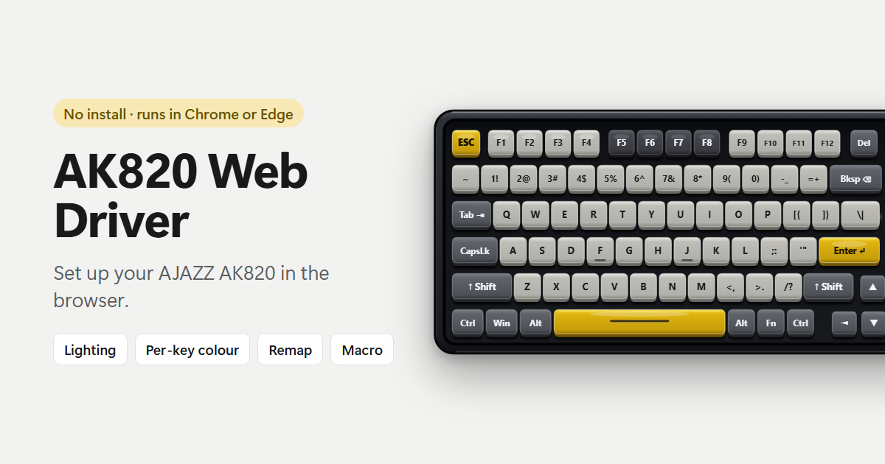

<div align="center">

# AK820 Web Driver

Configure the **AJAZZ AK820** mechanical keyboard from the browser.

**[Open the app → ak820-web.vercel.app](https://ak820-web.vercel.app)**

<a href="LICENSE"></a>
<a href="CHANGELOG.md"></a>
<a href="https://developer.mozilla.org/docs/Web/API/WebHID_API"></a>
<a href="https://react.dev"></a>
<a href="https://www.typescriptlang.org"></a>
<a href="https://vite.dev"></a>
<a href="https://nodejs.org"></a>

<br>



</div>

No install, no admin rights, and it runs on Windows, macOS and Linux wherever Chrome or Edge runs.

The vendor app is Windows-only. This driver talks to the keyboard directly over [WebHID](https://developer.mozilla.org/docs/Web/API/WebHID_API). Its protocol was reverse-engineered from the vendor app's USB traffic, every packet is checked byte for byte against captures, and every feature has been tested on real hardware.

> Independent and unofficial. Not affiliated with or endorsed by AJAZZ.

## Features

- **Lighting:** solid colour plus 17 built-in effects. Brightness (off to 4), speed, direction and random colour.
- **Per-key RGB:** click keys on the on-screen board to paint each one its own colour.
- **Key remap:** point any key at any standard key, or disable it. One click restores the factory layout.
- **Macro:** assign a typed-text macro (a–z, 0–9, space, up to 20 characters) to a key.
- **Keyboard options:** Windows-key lock, WASD ↔ arrow swap, and USB report rate (1000, 500, 250 or 125 Hz).
- **Profiles:** save, load, export and import lighting setups. Profiles stay in your browser.
- **Demo mode:** the whole UI works without a keyboard. Packets are recorded instead of sent. Open `/?demo` to jump straight in.
- **Key press and sound:** the on-screen board presses along as you type, with an optional switch sound.
- **Status lights:** the board's C / W lights follow Caps Lock and the Windows-key lock.
- **Phones:** phones can't reach a USB keyboard, so they get a short overview with *Send link to my computer*, *Copy link* and the demo.

Settings are written to the keyboard and survive unplugging.

## Requirements

| | |
|---|---|
| Browser | Chrome or Edge 89+ on a computer, or another Chromium browser. Firefox, Safari and all phone browsers can't connect. |
| Connection | USB-C cable, keyboard switched to **wired** mode |
| Page origin | HTTPS or `http://localhost` (WebHID needs a secure context) |
| Keyboard | AK820, EVision family (VID `0x320F`, PID `0x505B`), which is verified. The Sonix family (AK820 Pro) is best-effort. |

## Usage

1. Plug in the keyboard and set it to wired mode.
2. Open the app and click **Connect keyboard**, then pick the AK820 in the browser's device chooser.
3. Choose an effect and colour, then click **Apply to keyboard** (or press `Ctrl` + `Enter`).

Nothing is sent until you click Apply. The line next to the button lists what hasn't been sent yet.

Each page has its own link (`#perkey`, `#keys`, `#profiles`, `#settings`), so a refresh keeps you where you were.

### Where your settings live

- **On the keyboard:** whatever you Apply (lighting, per-key colours, remap, macro, options). It survives unplugging and works on any computer.
- **In your browser:** profiles and app settings, in `localStorage`. They never leave your browser; use *Export* / *Import* on the Profiles page to move them.

There's no server, account or tracking.

## Development

Requires Node.js 18 or newer.

```bash
npm install
npm run dev       # dev server at http://localhost:5180
npm run build     # type-check + production build into dist/
npm run preview   # serve the production build
npm run lint      # type-check only
npm run check     # protocol self-check against vendor captures
```

`npm run check` uses Node's built-in TypeScript type stripping, so it needs Node 22.6+ (or 23+).

Release notes live in [`CHANGELOG.md`](CHANGELOG.md). The version shown in the app comes from `package.json`.

## Deploying to Vercel

Import the repository in Vercel and keep the detected settings. [`vercel.json`](vercel.json) sets:

- the Vite build (`npm run build` into `dist/`);
- the security headers: Content-Security-Policy, `Permissions-Policy: hid=(self)` and no framing;
- year-long caching for the fingerprinted files in `/assets`.

Vercel serves over HTTPS, which WebHID needs. The link preview (`og:image`) points at `https://ak820-web.vercel.app`; update it in `index.html` if you use another domain.

Any other static host works too: serve `dist/` over HTTPS with the same headers.

## Project structure

```
├── index.html               Vite entry
├── public/                  logo (favicon.svg, PNG icons) and the link preview (og.png)
├── src/
│   ├── main.tsx             React entry
│   ├── App.tsx              app state, pages and apply flow
│   ├── styles.css           all styles
│   ├── components/          Shell, LightingPage, KeyboardView, BoardRender,
│   │                        KeyRemapPanel, ProfilesPanel, SettingsPanel, dialogs
│   └── lib/
│       ├── protocol.ts      packet builders, checksum, read-modify-write
│       ├── device.ts        WebHID controller and the demo (mock) controller
│       ├── keymap.ts        key layout and LED / keymap slot tables
│       ├── store.ts         localStorage persistence
│       ├── hooks.ts         React hooks
│       └── types.ts         shared types
├── scripts/check-protocol.ts  byte-exact protocol tests
├── docs/
│   ├── protocol.md          the AK820 protocol, as verified on hardware
│   └── legacy-protocol-notes.md  earlier notes, including the Sonix family
├── PRODUCT.md               product brief
├── CHANGELOG.md             release notes
└── vercel.json              deploy config and headers
```

## Protocol

Every write is a 64-byte HID output report:

- **Byte 0:** `0x04`.
- **Bytes 1–2:** a 16-bit little-endian checksum over bytes 3–63.
- **Byte 3:** the command.
- **Byte 4:** the length.
- **Bytes 5–6:** the offset.
- **Byte 8 onwards:** the data.

Writes are framed by begin (`01`) and end (`02`) packets. The commands are:

| Command | Purpose |
|---|---|
| `06` | lighting / options block (29 bytes) |
| `0B` | per-key colours |
| `09` | keymap |
| `15` | macro |
| `05`, `07`, `1B`, `03` | reads |

The full spec is in [`docs/protocol.md`](docs/protocol.md).

## Limitations

- One macro slot. The multi-macro layout hasn't been captured yet.
- Remap targets are standard keys only, with no media, mouse or Fn targets yet.
- The TFT screen, clock and image upload belong to the AK820 Pro/Max and aren't supported. For those, see [Beattrey/ajazz-ak820-config](https://github.com/Beattrey/ajazz-ak820-config).

## Troubleshooting

| Symptom | Fix |
|---|---|
| "This browser doesn't support WebHID" | Use Chrome or Edge. |
| The device chooser is empty | Check the cable and wired mode, or try another port. On Linux you may need a udev rule that gives your user access to the hidraw device. |
| `SecurityError` on connect | The page isn't a secure context. Use HTTPS or `localhost`. |
| Your unit has a different VID/PID | Turn on *Show all HID devices* in Settings and pick it by hand. |
| "The keyboard is busy" | Close the AJAZZ app, or any other tab using the keyboard, then connect again. |
| "That device isn't an AK820 keyboard" | Another USB device was picked. Nothing was sent to it; pick the AK820 instead. |
| A phone shows "open on a computer" | Expected: phones can't connect to USB keyboards. Use the demo, or send the link to a computer. |

## Credits

Earlier reverse-engineering work that helped:

- [OpenRGB](https://gitlab.com/CalcProgrammer1/OpenRGB): the `EVisionKeyboardController`
- [gohv/EPOMAKER-Ajazz-AK820-Pro](https://github.com/gohv/EPOMAKER-Ajazz-AK820-Pro)
- [TaxMachine/ajazz-keyboard-software-linux](https://github.com/TaxMachine/ajazz-keyboard-software-linux)
- [fpb/ajazz-ak820-pro](https://github.com/fpb/ajazz-ak820-pro)
- [Beattrey/ajazz-ak820-config](https://github.com/Beattrey/ajazz-ak820-config)
- [aar-rafi/aks075-linux](https://github.com/aar-rafi/aks075-linux)

## License

[MIT](LICENSE) © Abu Saleh Mohammad Jaeef
